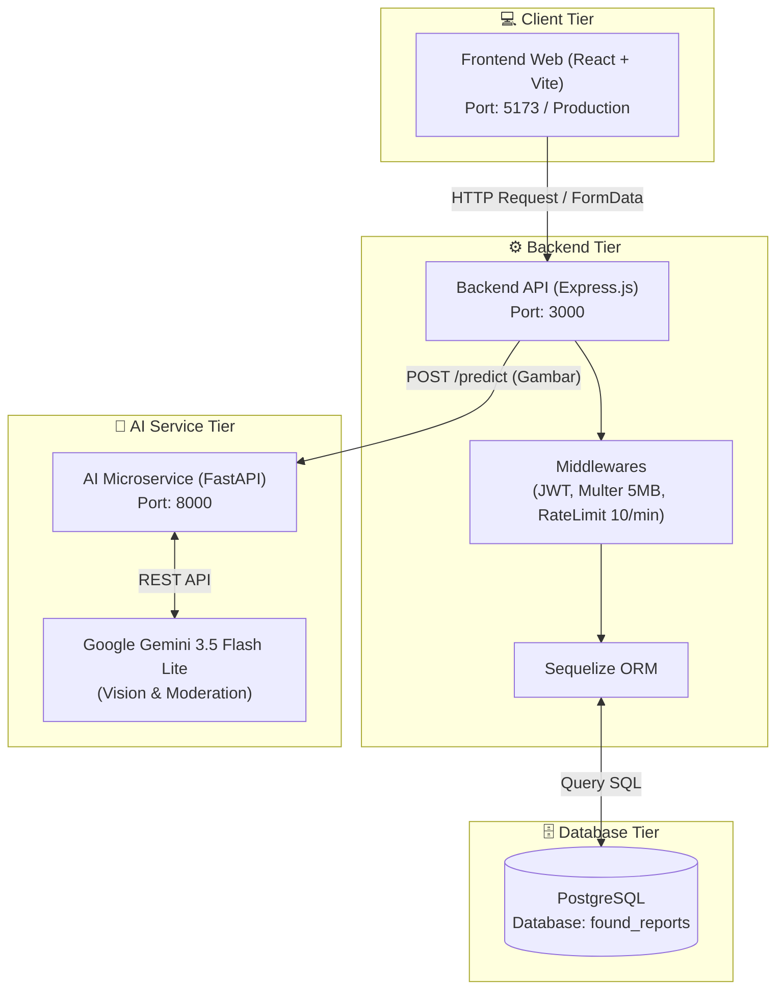

# 🔍 Lost & Found Platform — Smart Campus & Community

Aplikasi modern pelaporan dan pengelolaan barang hilang & temuan (**Lost & Found**) berbasis **Microservice Architecture** yang terintegrasi dengan **AI Vision Service (Google Gemini)** untuk deteksi objek otomatis, klasifikasi kategori, dan moderasi konten cerdas.

---

## 📌 1. Tentang Projek & Fungsi Aplikasi

Kehilangan atau menemukan barang di lingkungan kampus/publik sering kali mengalami kendala: proses birokrasi manual yang lambat, informasi yang tidak terpusat, maraknya laporan spam/palsu, serta ketidakjelasan tempat barang fisik disimpan.

Aplikasi **Lost & Found** ini hadir sebagai solusi terpadu:
* **Bagi Penemu Barang (Finder):** Dapat melaporkan barang temuan hanya dalam hitungan detik dengan memanfaatkan foto. AI otomatis mengisi nama, kategori, dan deskripsi barang.
* **Bagi Pemilik Barang (Owner):** Dapat menelusuri katalog publik dengan filter kategori dan pencarian instan untuk menemukan barang miliknya, serta mengetahui secara pasti di pos/ruang mana barang tersebut disimpan.
* **Bagi Petugas / Administrator:** Memiliki portal dashboard terproteksi untuk mendata, memverifikasi, mengubah status lokasi penyimpanan, hingga menghubungi penemu barang secara langsung via WhatsApp.

---

## ⚡ 2. Fitur-Fitur Utama

### 👤 A. Fitur Publik (User / Mahasiswa)
1. **📸 AI Vision Auto-Fill:** 
   Unggah foto barang temuan, dan sistem AI akan secara otomatis menganalisis serta mengisi nama barang (*label*), kategori (*category*), dan ciri-ciri visual (*description*) pada form.
2. **🛡️ Smart Content Moderation & Anti-Spam:**
   AI secara otomatis memeriksa kelayakan foto. Gambar yang mengandung pornografi/NSFW, kekerasan/senjata, ujaran kebencian/SARA, meme, selfie, screenshot, maupun foto buram/kosong akan ditolak secara langsung (`is_rejected: true`) disertai alasan yang jelas.
3. **🔍 Katalog Publik & Pencarian Real-Time:**
   Pencarian teks instan pada nama barang, deskripsi, lokasi penemuan, hingga lokasi penitipan dengan filter chip kategori.
4. **📍 Transparansi Ruang Penitipan (*Storage Rooms*):**
   Halaman detail barang mencantumkan pos atau ruangan tempat barang diamankan beserta jam operasional ruangan tersebut.
5. **✍️ Fallback Pengisian Manual:**
   Jika kamera atau foto tidak tersedia, pengguna tetap dapat membuat laporan barang temuan secara manual.

### 🛡️ B. Fitur Administrator & Petugas
1. **🔐 Autentikasi Terproteksi (JWT & Bcrypt):**
   Akses dashboard khusus administrator dengan token JWT yang memiliki masa berlaku dan sistem *auto-logout* jika sesi kedaluwarsa.
2. **📦 Manajemen Penuh Data Barang (CRUD):**
   Admin dapat menambah laporan langsung, memperbarui informasi (seperti memperbarui lokasi fisik barang yang sudah dipindahkan ke pos satpam), serta menghapus barang yang sudah selesai diklaim.
3. **📲 Quick WhatsApp Action:**
   Tautan otomatis untuk langsung membuka obrolan WhatsApp dengan penemu barang tanpa perlu menyimpan nomor terlebih dahulu.
4. **🏢 Pemantauan Ruang Penitipan:**
   Daftar seluruh ruang penitipan di setiap gedung untuk koordinasi antar-petugas keamanan/satpam.

### 🔒 C. Keamanan & Reliabilitas Sistem
1. **⏱️ Rate Limiting:**
   Pembatasan maksimal 10 request per menit pada endpoint AI untuk melindungi kuota API Google Gemini dari serangan *brute-force* atau spam.
2. **📁 File Size & MIME Guard:**
   Pembatasan ukuran file maksimal 5 MB dengan validasi ketat hanya menerima file gambar (`jpg`, `jpeg`, `png`, `webp`).
3. **🗄️ Sinkronisasi Database Otomatis:**
   Menggunakan Sequelize ORM dengan fitur migrasi otomatis sehingga database dan tabel langsung siap pakai tanpa perlu mengeksekusi file SQL secara manual.

---

## 🛠️ 3. Teknologi yang Digunakan (Tech Stack)

| Lapisan | Teknologi | Keterangan |
| :--- | :--- | :--- |
| **Frontend** | **React 18** + **Vite** | Single Page Application (SPA) yang cepat dan responsif |
| | **React Router DOM v6** | Routing antarmuka publik dan proteksi rute admin |
| | **Modern CSS** | Desain bertema *Campus Teal & Coral*, mobile-first |
| **Backend REST API**| **Node.js** + **Express.js** | Server backend modular dan performan |
| | **Sequelize ORM** | Object-Relational Mapping untuk PostgreSQL |
| | **JSON Web Token (JWT)** | Manajemen sesi autentikasi admin |
| | **Bcrypt** | Hashing password administrator yang aman |
| | **Multer** | Penanganan unggah berkas gambar dengan batasan 5 MB |
| | **Express Rate Limit** | Keamanan pembatasan request per IP |
| **AI Microservice** | **Python 3.10+** + **FastAPI** | Layanan independen untuk pemrosesan citra AI |
| | **Google Gemini 3.5 Flash Lite**| Vision LLM berkecepatan tinggi dengan output JSON terstruktur |
| | **Uvicorn** | ASGI server untuk menjalankan FastAPI |
| | **Pillow (PIL)** | Prapemrosesan dan konversi format citra |
| **Basis Data** | **PostgreSQL 14+** | Sistem basis data relasional utama |

---

## 🏗️ 4. Arsitektur Sistem



---

## 📂 5. Struktur Direktori Proyek

```text
lostandfound/
├── ai-service/                   # Microservice AI Vision (Python FastAPI)
│   ├── main.py                   # Endpoint FastAPI & Prompts Gemini Vision
│   ├── requirement.txt           # Dependensi Python
│   ├── .env.example              # Template env AI Service
│   └── README.md                 # Dokumentasi internal AI Service
│
├── backend/                      # Backend REST API (Node.js + Express)
│   ├── config/
│   │   └── db.js                 # Konfigurasi koneksi Sequelize PostgreSQL
│   ├── controllers/
│   │   ├── adminController.js    # Logika autentikasi & CRUD admin
│   │   └── foundController.js    # Logika laporan publik & integrasi AI
│   ├── database/
│   │   ├── migrate.js            # Script runner migrasi otomatis
│   │   └── schema.sql            # Definisi skema tabel SQL
│   ├── middlewares/
│   │   ├── authMiddleware.js     # Verifikasi Bearer Token JWT
│   │   ├── loggerMiddleware.js   # HTTP Request logger
│   │   ├── rateLimitMiddleware.js# Pembatas 10 req/menit
│   │   └── validationMiddleware.js# Validasi data laporan
│   ├── models/
│   │   ├── Admin.js              # Model Sequelize Admin
│   │   ├── Found.js              # Model Sequelize Found
│   │   └── index.js              # Inisialisasi relasi & model
│   ├── routes/
│   │   ├── adminRoutes.js        # Rute API admin (/api/admin)
│   │   └── foundRoutes.js        # Rute API publik (/api/founds)
│   ├── server.js                 # Entry point server Express
│   ├── package.json              # Dependensi backend
│   └── .env.example              # Template env backend
│
├── frontend/                     # Client Web App (React + Vite)
│   ├── src/
│   │   ├── api/
│   │   │   └── client.js         # Axios / Fetch client untuk semua endpoint
│   │   ├── components/           # UI Components (ItemCard, Field, Modal, Layouts)
│   │   ├── pages/                # Halaman aplikasi (Home, Catalog, Report, Admin)
│   │   ├── data/                 # Data statis (ruang penitipan)
│   │   ├── utils/                # Helper (formatDate, waLink, datetime converter)
│   │   ├── constants.js          # Kategori resmi & konfigurasi batas file
│   │   └── styles.css            # Desain antarmuka modern
│   ├── package.json              # Dependensi frontend
│   └── vite.config.js            # Konfigurasi bundler Vite
│
├── FRONTEND_API_GUIDE.md         # Panduan lengkap integrasi API untuk developer frontend
├── .gitignore                    # Berkas yang diabaikan Git
└── README.md                     # Dokumentasi utama proyek
```

---

## 🗄️ 6. Skema Basis Data

### Tabel `founds` (Menyimpan Data Barang Temuan)
| Kolom | Tipe Data | Keterangan |
| :--- | :--- | :--- |
| `id` | `SERIAL PRIMARY KEY` | ID unik otomatis bertambah |
| `label` | `VARCHAR(100) NOT NULL` | Nama barang (contoh: *"Dompet Kulit Lipat"*) |
| `category` | `VARCHAR(100) NOT NULL` | Kategori barang (salah satu dari 7 kategori resmi) |
| `deskripsi` | `TEXT` | Ciri-ciri visual barang *(opsional)* |
| `waktu_ditemukan` | `TIMESTAMP NOT NULL` | Waktu barang ditemukan *(default: waktu submit)* |
| `tempat_ditemukan` | `VARCHAR(255) NOT NULL` | Lokasi penemuan barang |
| `lokasi_penitipan` | `VARCHAR(255)` | Pos satpam / ruang penyimpanan barang *(opsional)* |
| `kontak_penemu` | `VARCHAR(100)` | Nomor WhatsApp atau kontak penemu *(opsional di DB)* |
| `created_at` | `TIMESTAMP` | Waktu data dibuat di sistem |

### Tabel `admins` (Menyimpan Akun Administrator)
| Kolom | Tipe Data | Keterangan |
| :--- | :--- | :--- |
| `id` | `SERIAL PRIMARY KEY` | ID unik administrator |
| `nama_admin` | `VARCHAR(100) NOT NULL UNIQUE` | Username admin |
| `password` | `VARCHAR(255) NOT NULL` | Password terenkripsi hash Bcrypt |
| `created_at` | `TIMESTAMP` | Waktu registrasi admin |

---

## 🏷️ 7. Kategori Standar Barang

Sistem dan AI Service dikonfigurasi untuk mengelompokkan barang ke dalam **7 kategori baku**:
1. `Elektronik` (Laptop, Smartphone, Charger, TWS, Flashdisk, dll.)
2. `Dompet & Kartu` (Dompet, KTM, KTP, Kartu Bank, STNK)
3. `Kunci` (Kunci Motor, Kunci Rumah, Gantungan Kunci)
4. `Dokumen` (Buku Catatan, Ijazah, Sertifikat, Map Dokumen)
5. `Perhiasan & Aksesoris` (Jam Tangan, Cincin, Kacamata, Gelang)
6. `Tas & Pakaian` (Ransel, Jaket, Helm, Topi, Sepatu)
7. `Lainnya` (Botol Minum/Tumbler, Payung, Alat Tulis)

---

## ⚙️ 8. Konfigurasi Lingkungan (`.env`)

### 1. `ai-service/.env`
```env
# Google Gemini API Key dari https://aistudio.google.com/
GEMINI_API_KEY=AIzaSyD_ContohApiKeyGoogleGeminiAnda
```

### 2. `backend/.env`
```env
PORT=3000
AI_SERVICE_URL=http://localhost:8000/predict

# Konfigurasi Database PostgreSQL
DB_HOST=localhost
DB_PORT=5432
DB_USER=postgres
DB_PASSWORD=password_postgresql_anda
DB_NAME=found_reports

# Kunci Rahasia JWT Token Admin
JWT_SECRET=rahasia_super_secure_lostandfound_jwt_key_2026
```

### 3. `frontend/.env`
```env
# URL endpoint Backend Express
VITE_API_URL=http://localhost:3000

# Tampilkan link pendaftaran admin di halaman login (true / false)
VITE_ENABLE_ADMIN_REGISTER=true
```

---

## 🚀 9. Panduan Instalasi & Menjalankan Proyek

### A. Menjalankan di Lingkungan Lokal (Development)

Pastikan layanan **PostgreSQL** sudah berjalan di komputer Anda, lalu buka 3 terminal terpisah:

#### Terminal 1 — AI Service (FastAPI)
```bash
cd ai-service

# Buat & aktifkan virtual environment
python -m venv venv
.\venv\Scripts\activate       # Windows PowerShell
# source venv/bin/activate    # Linux / macOS

# Install dependensi & konfigurasi env
pip install -r requirement.txt
cp .env.example .env          # Isi GEMINI_API_KEY di file .env

# Jalankan microservice
uvicorn main:app --reload --port 8000
```
> Berjalan di: `http://localhost:8000` (Swagger UI: `http://localhost:8000/docs`)

#### Terminal 2 — Backend API (Express.js)
```bash
cd backend

# Install dependensi
npm install

# Konfigurasi env
cp .env.example .env          # Sesuaikan kredensial DB PostgreSQL

# Jalankan migrasi database otomatis
npm run migrate

# Jalankan backend
npm start
```
> Berjalan di: `http://localhost:3000`

#### Terminal 3 — Frontend Web (React + Vite)
```bash
cd frontend

# Install dependensi
npm install

# Konfigurasi env
cp .env.example .env

# Jalankan server frontend
npm run dev
```
> Berjalan di: `http://localhost:5173`

---

### B. Panduan Deployment ke Server Produksi

Saat mendistribusikan aplikasi ke server produksi (VPS / Cloud Server):

1. **Database:**
   Gunakan managed PostgreSQL (seperti Supabase, AWS RDS, Neon, atau Railway). Masukkan kredensial koneksi ke `backend/.env`.

2. **AI Microservice:**
   Jalankan Uvicorn dengan mode *production workers*:
   ```bash
   gunicorn -w 4 -k uvicorn.workers.UvicornWorker main:app --bind 0.0.0.0:8000
   ```
   Atau menggunakan Docker / Process Manager (PM2).

3. **Backend API:**
   Gunakan **PM2** untuk menjaga server Node.js tetap menyala:
   ```bash
   npm install -g pm2
   cd backend
   pm2 start server.js --name "lostandfound-backend"
   pm2 startup
   ```

4. **Frontend:**
   Lakukan build static assets:
   ```bash
   cd frontend
   npm run build
   ```
   Folder `frontend/dist` dapat disajikan menggunakan **Nginx** dengan konfigurasi SPA Fallback (`try_files $uri $uri/ /index.html;`) atau dideploy ke platform serverless seperti **Vercel** / **Netlify**.

---

## 📡 10. Dokumentasi Endpoint API

Untuk panduan integrasi frontend detail, lihat **[FRONTEND_API_GUIDE.md](FRONTEND_API_GUIDE.md)**.

### Endpoint Publik (User)
| Method | Endpoint | Deskripsi | Format Data |
| :---: | :--- | :--- | :--- |
| `POST` | `/api/founds/classify` | Pindai foto barang menggunakan AI | `multipart/form-data` (`image`) |
| `POST` | `/api/founds` | Kirim laporan barang temuan baru | `application/json` |
| `GET` | `/api/founds` | Ambil semua barang *(support `?search=&category=`)* | Query Params |
| `GET` | `/api/founds/:id` | Ambil detail satu barang berdasarkan ID | URL Params |

### Endpoint Terproteksi (Admin)
> Wajib menyertakan Header: `Authorization: Bearer <TOKEN_JWT>`

| Method | Endpoint | Deskripsi | Akses |
| :---: | :--- | :--- | :---: |
| `POST` | `/api/admin/auth/register` | Mendaftarkan administrator baru | Publik / Terbatas |
| `POST` | `/api/admin/auth/login` | Login admin & mendapatkan token JWT | Publik |
| `GET` | `/api/admin/founds` | Melihat seluruh barang temuan untuk admin | Admin |
| `GET` | `/api/admin/founds/:id` | Melihat detail satu barang untuk admin | Admin |
| `POST` | `/api/admin/founds` | Menambah barang secara manual oleh admin | Admin |
| `PUT` | `/api/admin/founds/:id` | Memperbarui data barang (lokasi/deskripsi) | Admin |
| `DELETE` | `/api/admin/founds/:id`| Menghapus barang yang sudah selesai diklaim | Admin |

---

## 🛡️ 11. Format Penolakan AI (`is_rejected: true`)

Jika gambar yang diunggah terdeteksi melanggar ketentuan atau tidak relevan, sistem akan mengembalikan status penolakan bersih:

```json
{
  "success": false,
  "is_rejected": true,
  "rejection_reason": "Gambar hanya berupa warna solid atau latar belakang polos tanpa objek barang yang jelas, sehingga tidak memenuhi syarat untuk dipublikasikan sebagai laporan barang hilang.",
  "label": null,
  "category": null,
  "deskripsi": null,
  "predictions": null,
  "data": null
}
```

---

## 👥 Pengembang & Lisensi

Projek ini dikembangkan sebagai bagian dari tugas **Manajemen Proyek - Sistem Informasi Barang Hilang & Temuan**.  
Didistribusikan di bawah lisensi terbuka untuk tujuan akademis dan pengembangan kampus.
